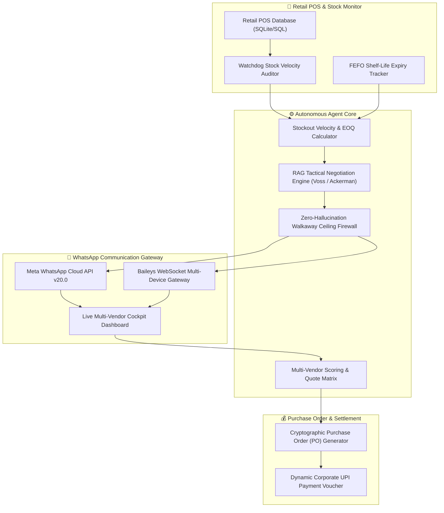

# 🌿 Autonomous Inventory Replenishment & WhatsApp Sourcing Agent

[](https://nodejs.org/)
[](https://expressjs.com/)
[](https://developers.facebook.com/docs/whatsapp/cloud-api)
[](https://github.com/WhiskeySockets/Baileys)
[](https://aistudio.google.com/)
[](https://github.com/gokulblee-code/invnetroy-agent-)
[](LICENSE)

An autonomous, production-grade retail inventory procurement platform tailored for retail enterprises and wholesale nurseries. It bridges directly with local Retail POS systems, evaluates inventory levels and stockout velocity in real time, and conducts multi-vendor wholesale price negotiations autonomously via **Meta WhatsApp Business Cloud API**, **Baileys WebSocket Gateway**, and **Google Gemini LLM RAG agents**.

---

## 📑 Table of Contents
- [System Architecture](#-system-architecture)
- [Dual-Model Deployment Architecture](#-dual-model-deployment-architecture)
- [Core Capabilities](#-core-capabilities)
- [Tactical RAG Negotiation Engine](#-tactical-rag-negotiation-engine)
- [POS Bridge & Inventory Intelligence](#-pos-bridge--inventory-intelligence)
- [Security & Zero-Leak Protocol](#-security--zero-leak-protocol)
- [Quickstart & Installation](#-quickstart--installation)
- [Environment Configuration](#-environment-configuration)
- [Developer & Community](#-developer--community)

---

## 🏛️ System Architecture



---

## 🏢 Dual-Model Deployment Architecture

The platform supports two deployment models to accommodate single-store retailers and enterprise multi-location chains:

| Specification | Model 1: Centralized Company Gateway | Model 2: Bring-Your-Own-Number (BYON) |
| :--- | :--- | :--- |
| **Port & URL** | `5011` (`/inventory-agent-ui`) | `5012` (`/inventory-agent-ui`) |
| **Target Store Setup** | **Zero Setup** — store owners do not need Meta Developer accounts. | Store registers their dedicated WhatsApp Business Number in Meta Business Manager. |
| **Outreach Identity** | Dispatches from company-verified master sender on behalf of store (`"Alex from Merlot Decor"`). | Dispatches directly from the store’s branded official business number. |
| **Free Tier Allowance** | Consolidated company pool (1,000 free chats/month). | Each merchant receives their own 1,000 free service conversations/month from Meta. |
| **Batch Sizing** | Default batch size: `30 units` | Default batch size: `50 units` |
| **Best For** | Instant SaaS client onboarding without technical overhead. | Supermarkets, franchises, and enterprise brand owners. |

---

## ✨ Core Capabilities

### 1. 📱 Autonomous WhatsApp Procurement Cockpit
* **Dual WhatsApp Engine**: Native integration with both official **Meta WhatsApp Cloud API v20.0** and self-hosted **`@whiskeysockets/baileys`** WebSocket engine.
* **Live In-Browser Cockpit**: Real-time multi-threaded conversation view with turn-by-turn timestamps, delivery receipts, and live typing indicators.
* **Concurrent Vendor Outreach**: Dispatches simultaneous RFQs to all suppliers mapped to a low-stock SKU when stock drops below threshold.
* **Emergency Circuit Breaker**: One-click kill switch to freeze all autonomous outbound communication instantly.

### 2. 🧠 Tactical RAG Negotiation Engine
* **Chris Voss Tactical Empathy**: Employs open-ended calibrated questions (*"How are we supposed to accept that rate with same-day dispatch?"*) to anchor vendor quotes downward.
* **Ackerman Bargaining Model**: Automatically steps concessions (65% $\rightarrow$ 85% $\rightarrow$ 95% $\rightarrow$ 100% of target price) based on vendor resistance.
* **Walkaway Price Ceiling Firewall**: Programmatically enforces maximum acceptable unit prices. If a vendor refuses to meet ceiling limits, the agent politely disengages and routes to alternative suppliers.

### 3. 📊 POS Bridge & Inventory Forecasting
* **Real-Time POS Sync**: Directly connects with `localdb.sqlite` / products tables to monitor stock movements.
* **Velocity Metrics**: Dynamically computes 7-day sales velocity ($V$), Days of Inventory remaining ($\text{DOI}$), and dynamic Reorder Points ($\text{ROP}$).
* **Economic Order Quantity (EOQ)**: Balances annual unit demand, fixed procurement costs, and holding expenses to output mathematically optimal batch sizes.
* **FEFO Expiry Auditing**: Categorizes perishables and nursery stock by shelf-life decay (Critical $\le 2$ days, Warning $3-7$ days) and triggers automated markdown sales campaigns.

### 4. 🧾 Cryptographic Purchase Orders & Dynamic UPI Settlement
* **PO Issuance**: Generates immutable, uniquely hashed Purchase Orders (`PO-MERLOT-XXXXXX`) upon deal lock.
* **Corporate UPI Vouchers**: Dynamically outputs UPI settlement intent strings and QR payment codes for immediate vendor payment upon physical delivery verification.

---

## 🔒 Security & Zero-Leak Protocol

This repository is strictly protected under enterprise secret hygiene:
* **Zero Secret Commitment**: All `.env` files, Meta Access Tokens, WhatsApp Web credentials (`baileys_auth/`), and SQLite transaction databases are strictly ignored via `.gitignore`.
* **Sanitized Templates**: Complete environment configuration templates are provided in [`.env.example`](.env.example).
* **Anti-Prompt Injection Defense**: Vendor messages are sanitized prior to LLM evaluation to prevent jailbreaks, prompt injection, and artificial price overrides.

---

## 🚀 Quickstart & Installation

### 1. Clone the Repository
```bash
git clone https://github.com/gokulblee-code/invnetroy-agent-.git
cd invnetroy-agent-
```

### 2. Install Dependencies
```bash
npm install
```

### 3. Configure Environment
```bash
cp .env.example .env
```
Fill in your credentials in `.env`:
* `META_WA_PHONE_NUMBER_ID` & `META_WA_ACCESS_TOKEN` (for official Meta Cloud API)
* `GEMINI_API_KEY` (Free API key from [Google AI Studio](https://aistudio.google.com/))
* `PORT=5001`

### 4. Start the Agent
```bash
# Production Launch
npm start

# Or Launch Standalone Server
node server.js
```

### 5. Access the Cockpit Dashboard
Open your browser and navigate to:
```
http://localhost:5001/
```
Or view the agent cockpit directly at:
```
http://localhost:5001/inventory_agent.html
```

---

## 👨‍💻 Developer & Community

Architected by **GokulBlee** — *Vibe Code Developer in Any Language with Core Logic | Pro in Antigravity • Git • VS Code*.

* **GitHub**: [@gokulblee-code](https://github.com/gokulblee-code)
* **Live Portfolio**: [gokulblee-code.github.io/portfolio](https://gokulblee-code.github.io/portfolio/)
* **Discord Community**: [The Vibe Code Hub](https://discord.gg/yem2HkTGN)

---

## 📄 License
This project is licensed under the [MIT License](LICENSE).
